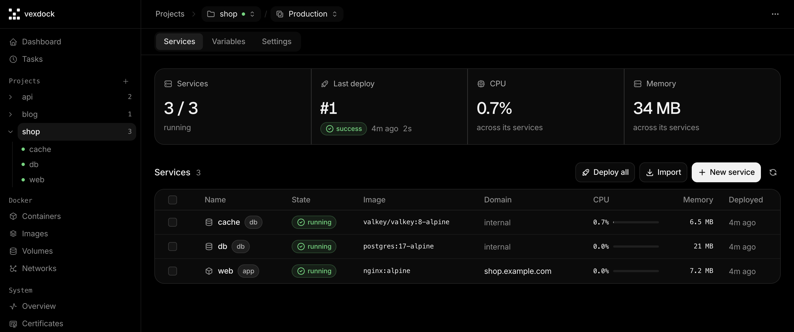

<div align="center">


# Vexdock

**The open-source, self-hosted alternative to Vercel, Heroku and Netlify.**<br>
Push to Git, get a container, a domain and HTTPS on a server you own.

[](https://github.com/rokartur/vexdock/actions/workflows/ci.yml)
[](https://github.com/rokartur/vexdock/releases/latest)
[](LICENSE)

[Website](https://vexdock.com) · [Install](#install) · [Features](#features) · [Docs](#documentation) · [API](docs/api.md)

</div>

<br>



<br>

Vexdock gives you the `git push` workflow of Vercel and Netlify and the
one-click databases of Heroku, on any Linux server you rent or own. You pay for
the server, not per build minute, seat or gigabyte. Every app is an ordinary
Docker Compose project, so `docker compose up` keeps working the day you remove
Vexdock.

## Install

On a fresh Ubuntu 22.04+ or Debian 12+ server, as root:

```sh
curl -fsSL https://raw.githubusercontent.com/rokartur/vexdock/main/installer/install.sh | sudo sh
```

The script installs Docker if it is missing, starts the stack and prints the
dashboard address with a one-time setup token. Open it, paste the token and
create the administrator.

Update from the dashboard in one click, or from the shell:

```sh
curl -fsSL https://raw.githubusercontent.com/rokartur/vexdock/main/installer/install.sh | sudo sh -s update
```

Options, restoring a backup and uninstalling: [docs/install.md](docs/install.md).

## Features

**Deploy**

- **From anywhere.** GitHub (an App created for you through the manifest flow), GitLab, Gitea, Bitbucket, any Git URL, a Docker image or a pasted Compose fragment.
- **Push to deploy.** Webhooks per Git host, or a deploy from CI with an API token.
- **A pipeline you can watch.** `clone → checkout → validate → pull → build → start → healthcheck → proxy → finish`, streamed live.
- **Rollback.** Every deployment records its commit. Redeploy any of them from the history.
- **Environments.** Production and staging in one project, each with its own branch, variables, containers, volumes and network.

**Domains and HTTPS**

- **Add a domain, pick a port.** Nginx config is generated, validated and reloaded. Let's Encrypt issues and renews the certificate.
- **Wildcards** through DNS-01 with a Cloudflare API token, or **your own certificate**.
- **Redirects and basic auth** per service, live when you save.

**Databases and templates**

- **One-click engines.** PostgreSQL, MySQL, MariaDB, MongoDB, Valkey and libSQL, with the image, volume and credentials generated.
- **Studio.** Browse, filter and edit rows, or run a query, from the dashboard. No published port, and the credentials never reach the browser.
- **Templates.** n8n, Ghost, WordPress, Umami, Metabase, Grafana, Uptime Kuma and Vaultwarden in one step.

**Operate**

- **Logs, metrics and a terminal** for every container, in the browser.
- **Scheduled tasks.** A cron expression, a timezone and a command, run inside the service's container. Every run keeps its exit code and output.
- **The whole Docker host.** Containers, images, volumes and networks, including stacks Vexdock did not create, with a previewed cleanup.
- **Backups and self-update.** A backup comes first, and an update that never turns healthy rolls back on its own.
- **REST API and an agent skill.** The API the dashboard uses, with bearer tokens. [`skills/vexdock-api`](skills/vexdock-api/SKILL.md) teaches an AI agent to operate a host through it.

## Why Vexdock

| | Vercel / Netlify / Heroku | Vexdock |
|---|---|---|
| Price | Per seat, build minute, bandwidth, dyno | The server you already pay for |
| Your data | On their cloud | On your disk |
| Workloads | Mostly frontends and serverless | Any container: APIs, workers, databases, cron |
| Leaving | Rewrite configs for the next platform | Plain Compose files, keep running |
| Source | Closed | Open, AGPL-3.0 |

One server, done well: Kubernetes, multi-server orchestration and autoscaling
are out of scope. Nginx, not Traefik, and the reason is in
[docs/architecture.md](docs/architecture.md#why-nginx-and-not-traefik).
Secrets are encrypted at rest under a master key only the host holds
([docs/security.md](docs/security.md)).

## How it works

Three containers. Nginx is the only public entry point.

| Component | Role |
|---|---|
| `vexdock-manager` | Go binary. Owns the Docker socket, SQLite state, the deploy pipeline, Nginx generation and ACME. |
| `vexdock-auth` | better-auth on Bun. Owns accounts and sessions; the manager only validates them. |
| `vexdock-nginx` | Reverse proxy for every application plus the static dashboard. |

Applications are ordinary compose projects on a shared `vexdock-proxy` network
under a stable alias, so a recreated container keeps serving without a proxy
change.

<details>
<summary>State lives in <code>/opt/vexdock</code></summary>

```
/opt/vexdock
├── compose.yml          system stack
├── .env                 version, options, session secret, setup token (0600)
├── data/app.db          SQLite: projects, domains, deployments
├── data/auth.db         SQLite: accounts and sessions (better-auth)
├── projects/<id>/       one directory per environment (.env, managed.yml and
│                        services/ with a checkout and an env file per service);
│                        a project's default environment uses the project's id
├── nginx/generated/     one .conf per domain, written by the manager
├── nginx/custom/        yours: .conf files Nginx includes, the manager never writes
├── certificates/        Let's Encrypt certificates and the account key
├── secrets/             master.key, the AES key protecting secrets in the
│                        database (0600), and known_hosts for SSH clones
├── system/              update script, previous compose.yml, update-state.json
│                        (the update progress the panel polls) and docker/, the
│                        registry logins `docker login` keeps
└── backups/<stamp>/     both databases, master key, config-compose.yml,
                         config-env (the system .env), nginx/, certificates,
                         volumes/ on request;
                         .updates/<stamp>/ holds what a shell update copies
                         before it replaces the stack
```

</details>

## Requirements

- Ubuntu 22.04+ or Debian 12+, amd64 (the published images are amd64 only)
- 1 GB RAM (2 GB if you build images on the server)
- Ports 80, 443 and 3000 free

## Documentation

| | |
|---|---|
| [Install](docs/install.md) | Installing, updating, restoring, moving from Dokploy, uninstalling |
| [Architecture](docs/architecture.md) | How the pieces fit, the deploy pipeline, networking, self-update |
| [API](docs/api.md) | REST API, tokens, SSE streams, webhooks, deploy from CI |
| [Security](docs/security.md) | Trust boundary, CSRF, secrets, encryption |
| [Troubleshooting](docs/troubleshooting.md) | When something breaks |
| [Codebase](docs/codebase.md) | Layout, vocabulary, sequence diagrams of deploy, domains, reconcile, sign-in and self-update |

## Development

```sh
make check      # go vet, go test, typecheck
make dev-up     # build the three images and run the whole stack locally
make web-dev    # dashboard on :5173 with HMR, proxying /api to the stack
./scripts/smoke-test.sh
```

`make help` lists the rest. Conventions, tests and releasing are in
[CONTRIBUTING.md](CONTRIBUTING.md).

## License

[AGPL-3.0](LICENSE). If you run a modified version as a network service, you
must publish those modifications.
