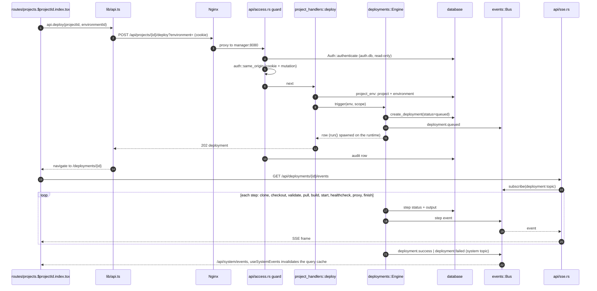
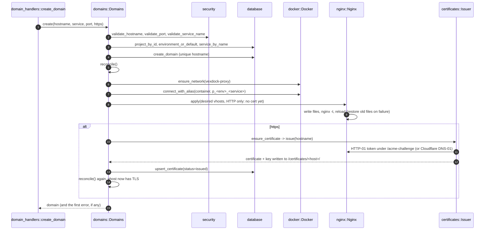
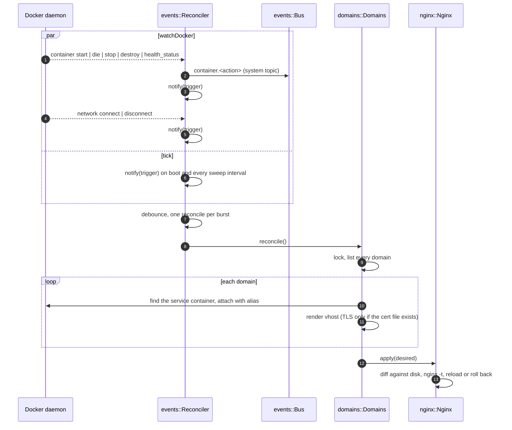
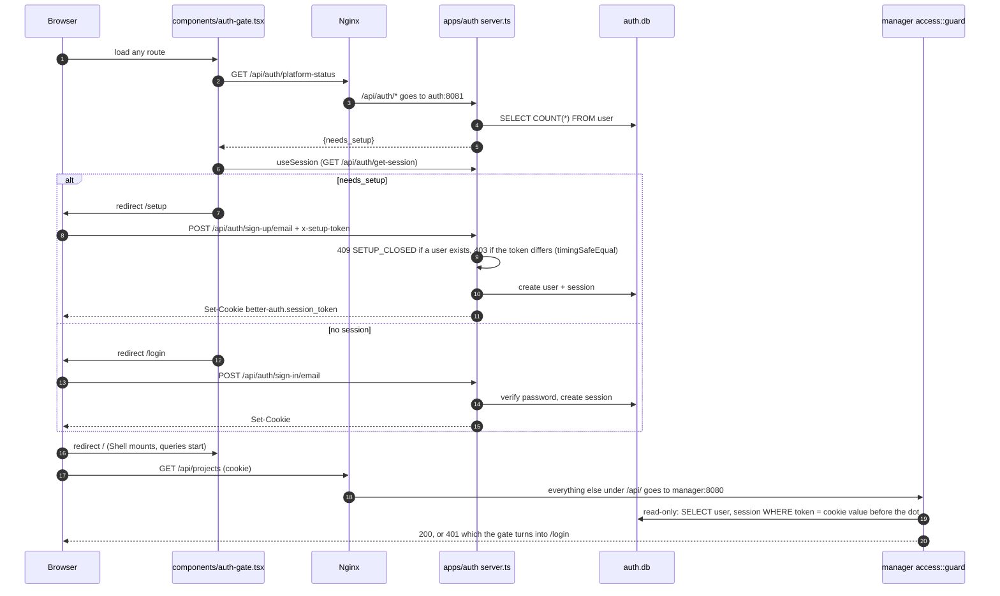
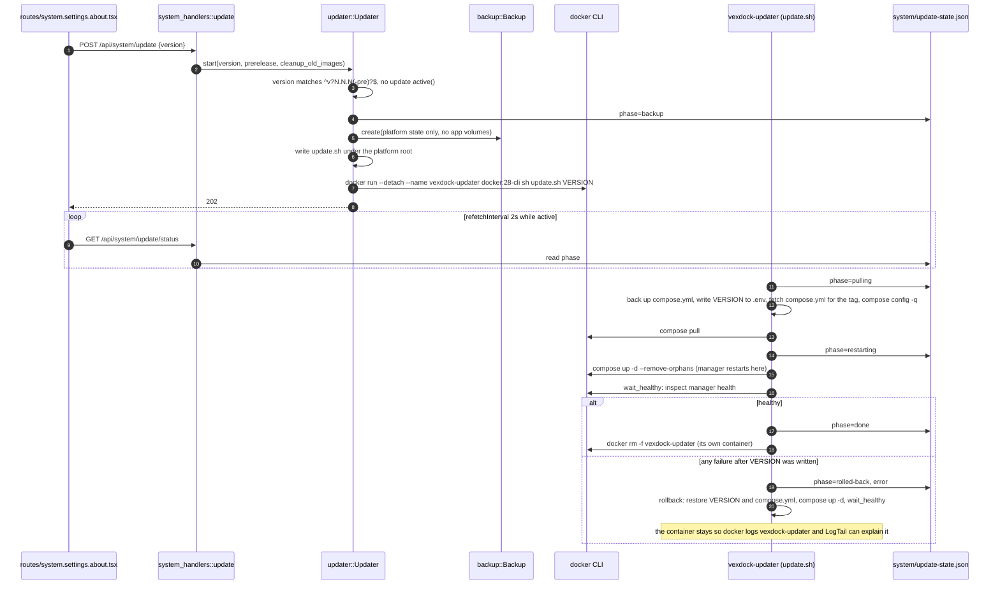

# Reading the code

The first day in this repository. [architecture.md](architecture.md) says why
the system is shaped the way it is; this file says where each piece of that
shape lives in the tree and how a request moves through it.

## Start here

Read in this order, about an hour in total:

1. `manager/src/api/mod.rs`: `Server::new` constructs every subsystem, the
   dependency graph in about 30 lines; `router()` below it is the route table
   with each route's access level.
2. `manager/src/api/access.rs`: `guard`, the whole auth and CSRF story in one
   function.
3. One handler file, `manager/src/api/domain_handlers.rs`: the pattern every
   endpoint follows.
4. `manager/src/bin/manager.rs`: boot, the background tasks and the listeners.
5. `apps/web/src/lib/api.ts`: the dashboard's only way to talk to the manager.
6. One page, `apps/web/src/routes/docker.networks.tsx`: the pattern every page
   follows.

Every Rust module opens with a `//!` comment naming what it owns and why it
exists. `cd manager && cargo doc --open` renders them all.

## Words

| Word | Meaning |
|---|---|
| **Project** | A grouping with a name and tags. Has no source and no containers of its own. |
| **Environment** | A deployable copy of a project (production, staging). Owns the compose project name `p_<ULID>`, the directory under `projects/<id>/` and the services. Every project has a default environment that carries the project's own id. |
| **Service** | One compose service inside an environment. Its `provider` says where it comes from: a git host (`github`, `gitlab`, `bitbucket`, `gitea`, `git`), a published `image`, a pasted `raw` compose fragment, or `unconfigured` (a name and nothing else, skipped on deploy). |
| **Engine** | A catalog entry for a one-click database: PostgreSQL, MySQL, MariaDB, MongoDB, Valkey, libSQL. Picking one creates an `image` service with a volume and generated credentials, except libSQL, which authenticates with a JWT key rather than a password and starts open to its project network. |
| **Template** | A catalog entry for a one-click application: n8n, Ghost, WordPress, Umami, Metabase, Grafana, Uptime Kuma, Vaultwarden. Installing one creates a `raw` service per compose service it declares, seeds the passwords and hostname it needs as environment variables, and points the hostname at the service that serves it. Nothing records that a service came from a template. |
| **`managed.yml`** | The one compose file the platform generates per environment from every configured service. The only file ever passed to `docker compose`. |
| **Deployment** | One run of the pipeline for one service of one environment. Has steps, each with a status and captured output. Deploying an environment queues one per service. |
| **Step** | A stage of the pipeline: `clone`, `checkout`, `validate`, `pull`, `build`, `start`, `healthcheck`, `proxy`, `finish`. |
| **Domain** | A hostname mapped to one service and one container port. Gets a generated Nginx vhost and a certificate. |
| **Alias** | The stable name `p_<environment-id>_<service>` a service carries on the `vexdock-proxy` network. Nginx resolves it at request time, so a recreated container needs no proxy change. |
| **Reconcile** | The full convergence pass: attach every domain's container to the proxy network under its alias, render every vhost, `nginx -t`, reload. Runs on Docker events and every two minutes. |
| **Git provider** | A stored connection to a git host (GitHub App, GitLab, Bitbucket, Gitea OAuth) used to list repositories and clone. Distinct from a service's `provider` field, which only says what kind of source it is. |
| **Project token** | An API token limited to listed projects, each at `read` or `write`. Its opposite is an admin token, which reaches every route as a dashboard session does. |
| **OAuth grant** | An API token an MCP client got through OAuth instead of a person creating it: it has a `client_id`, its access token rotates hourly and its refresh token on every use. Same scopes, same revoke. |
| **Task** | A cron job that runs a command inside a service's container. |
| **Bus** | The in-process pub/sub in `src/events`. Everything a browser sees live comes off it. |

## One request, end to end

Pressing **Deploy** on a project page.



1. `routes/projects.$projectId.index.tsx` calls `api.deploy(projectId, environmentId)`
   inside a `useMutation`.
2. `lib/api.ts` `request()` sends `POST /api/projects/{id}/deploy?environment=...`
   with `credentials: 'same-origin'`. No token: the session cookie is the credential.
3. Nginx (`docker/nginx/dashboard.conf`) proxies `/api/` to `manager:8080`. It
   adds `X-Forwarded-Proto` and `X-Real-IP` on the way.
4. `router()` in `api/mod.rs` matches `POST /api/projects/{id}/deploy` and puts
   `access::guard` in front of the handler: `Auth::authenticate` reads the
   session out of `auth.db`, then because this is a cookie-authenticated
   mutation, `auth::same_origin` compares `Origin` with the addressed host.
   Fail either and the handler never runs.
5. `deploy` in `project_handlers.rs` calls `s.project_env(&id, &q)`, which
   loads the project and resolves `?environment=` (falling back to the default),
   then `deployments.trigger(...)`.
6. `Engine::trigger` in `deployments/mod.rs` inserts a `queued` row through
   `Db::create_deployment`, publishes `deployment.queued` on the bus, spawns
   `run` on the Tokio runtime and returns. The handler answers `202` with the
   row; the HTTP request is never held open by a build.
7. `guard` records the mutation in the audit log with the actor, path and
   status.
8. The dashboard navigates to the deployment page, which opens
   `GET /api/deployments/{id}/events`. `api/sse.rs` subscribes to the bus topic
   for that deployment and streams every step and output line.
9. `run` takes the per-environment lock, then walks the steps. Each step is
   written to the database and published on the bus as it changes. `start`
   shells out through `compose`; `proxy` calls `Domains::reconcile`.
10. On finish the engine publishes `deployment.success` (or `failed`) on the
    system topic. `lib/sse.ts` `useSystemEvents`, mounted once in the shell,
    listens on `/api/system/events` and invalidates the whole query cache, so
    every page refetches without polling.

Reads are the same path minus the same-origin check and the audit row.
Anything with a bearer token skips the same-origin check too: a browser never
attaches one on its own.

### Adding a domain

The path from a hostname in a form to a certificate on disk. Everything after
`create_domain` is best-effort: the mapping exists even if the proxy or ACME
part fails, and the error tells the user which one did.



### Reconcile on a Docker event

Why a recreated container keeps its domain without anyone doing anything.
The same `Reconcile` runs from the deploy pipeline's `proxy` step, from every
domain mutation, and from here.



A stopped container is skipped with a debug log, not an error, so one dead
service never blocks the config for the rest.

### First boot and sign-in

The auth service owns accounts; the manager only reads them. The setup token
is the whole defense of a fresh panel on a public IP: without it the first
visitor would own the Docker socket.



The gate holds the route back until both queries answer, so an unauthenticated
visitor never mounts the shell and fires a burst of 401s. A bearer
`Authorization` header takes the other branch in `Auth::authenticate`: the
token hash is looked up in the manager's own `api_tokens` table, and the user
row is read from `auth.db` for its current name. The token rides on the user
(`User::token`), and the route's `Access` in `api/access.rs` checks it against
the project the route resolves.

### Self-update

The manager cannot replace its own container, so it launches a detached one
that does. Progress lives in `system/update-state.json`, which is why the
panel can keep rendering while the manager itself is being recreated.



Every error before `docker run` resets the state file to `idle`; every error
after `VERSION` is written goes through `rollback`, never through `set -e`.

## The tree

| Path | What |
|---|---|
| `manager/` | The Rust manager, [below](#manager) |
| `apps/web/` | The dashboard, [below](#dashboard) |
| `apps/auth/` | The auth service, [below](#auth-service) |
| `compose.yml` | The production stack the installer fetches for a release tag; `compose.dev.yml` overlays local builds and `./.vexdock` on it |
| `docker/` | One Dockerfile per image; `nginx/` holds Nginx's own config: `nginx.conf` (rate-limit zones), `dashboard.conf` (the panel's server block and the `/api`, `/mcp` and `/.well-known/oauth-` split), `proxy-headers.conf` (shared by every proxying location) |
| `installer/install.sh` | Install, update and uninstall on a host. `PLATFORM_LOCAL_COMPOSE` points it at a local compose file, which is how CI runs it; `PLATFORM_RAW_BASE` swaps the base URL it downloads `compose.yml` from |
| `scripts/` | `smoke-test.sh` (the real deploy path against a running stack), `release-beta.sh` and `migrate-dokploy.ts` (one Dokploy project, volumes included) |
| `site/index.html` | The landing page: one self-contained file, no build |
| `skills/vexdock-mcp/` | An agent skill describing the MCP server: how to connect, what each tool does, what the errors mean. Shipped to users, so it moves with the tool list in `manager/src/bin/mcp/tools.rs` |
| `.pi/skills/release-beta/` | The maintainer's skill that drives `make release-beta` |
| `.github/workflows/` | `ci.yml` (checks, shellcheck, a real installer run followed by the smoke test), `release.yml` (images on a `v*.*.*` tag), `delete-merged-branch.yml` |

## Manager

`manager/` is one Cargo crate: a library with one module per concern and two
binaries on top of it. HTTP is axum on Tokio, SQLite is rusqlite (bundled),
Docker is bollard, and it shells out to `git` and `docker compose`.

| Module | Owns |
|---|---|
| `src/bin/manager.rs` | The manager binary: config, boot-time recovery, background tasks, the listeners, `-healthcheck` |
| `src/bin/mcp/` | The MCP server, its own image: streamable HTTP by hand in `main.rs`, tools in `tools.rs` that call the manager's REST API with the caller's token |
| `src/api` | `Server::new` and the route table in `mod.rs`, one `*_handlers.rs` per resource, the SSE writer; `access.rs` holds the `Access` levels, the `guard` every authenticated route goes through and the project resolvers; `oauth_handlers.rs` is the OAuth authorization server for MCP clients |
| `src/auth` | Session lookup in `auth.db`, API tokens, the same-origin check |
| `src/backup` | Snapshots of both databases, proxy config, certificates, volumes |
| `src/certificates` | ACME issuance (HTTP-01 and Cloudflare DNS-01), uploaded certificate validation |
| `src/compose` | The `docker compose` CLI wrapper |
| `src/config.rs` | Environment variables to paths and settings; creates the state directories |
| `src/database` | The SQLite connection, migrations, models and every query |
| `src/deployments` | The pipeline |
| `src/docker` | Docker SDK wrapper: containers, images, volumes, networks, exec, stats |
| `src/domains` | Hostname to service, proxy attachment, vhost rendering, reconcile |
| `src/engines` | The database catalog and the compose fragment each engine renders |
| `src/events` | The bus and the Docker event reconciler |
| `src/git` | Clone with credentials, GitHub App JWTs, OAuth for the other hosts |
| `src/metrics` | Host and container sampling into the metrics tables |
| `src/nginx` | Vhost generation with a service's redirects and basic auth, `.htpasswd` files, `nginx -t`, reload with byte-for-byte rollback |
| `src/projects` | Project and environment lifecycle, on-disk layout, `managed.yml` rendering, import/export |
| `src/schedule` | Cron parsing and the task runner |
| `src/security` | Validation of anything that reaches a command line, AES-GCM cipher, path confinement, token hashing |
| `src/studio` | Studio: schema, rows, edits and queries against a catalog database, one file per wire protocol |
| `src/templates` | The application catalog: the compose services one entry installs and the values it seeds |
| `src/updater` | Self-update: state file, the detached updater container, `update.sh` |
| `migrations` | `000N_name.sql`, embedded, applied in order on boot |

Dependency direction: `database` uses only the driver. Business modules
(`projects`, `domains`, `deployments`, ...) use `database`. `api` uses
everything and is used by nothing but the two binaries. Keep it that way: a
module reaching back up is logic in the wrong module.

### Conventions you will see everywhere

- A handler returns `ApiResult`: it decodes with `decode`, answers with `ok`,
  `created` or `done`, and fails with `bad_request`, `lookup` or `?` on an
  `anyhow::Error` (`api/respond.rs`). Every error is
  `{"error": {"code", "message", "details"}}`.
- Project routes take `?environment=`; `s.project_env(&id, &q)` resolves it.
- A route is one `.route("METHOD /path", access, handler)` line in `router()`,
  with `Public`, `SignedIn`, `Admin` or `Project(level, ProjectOf::...)`
  (`api/access.rs`); there is no fifth way.
- Anything a user typed that will end up in an argv, a file name or a YAML
  file goes through `src/security` first.
- Secrets are stored through `security::Cipher` and never logged or returned.
- Long work is spawned on the runtime and answers `202`; progress goes on the bus.
- Every timestamp is `database::now()`, RFC3339 UTC, so string comparison in
  SQL sorts correctly.
- Logging is `tracing`, JSON lines on stdout.

## Dashboard

`apps/web/` is TanStack Start in SPA mode, built to static files that Nginx
serves. React Query holds server state; component state stays local.

| Path | What |
|---|---|
| `src/routes/*.tsx` | One file per page; the filename is the URL. `projects.$projectId.settings.tsx` is `/projects/:projectId/settings`. A `_` before a dot (`projects.$projectId_.services...`) makes the child render outside its parent's layout. `routeTree.gen.ts` is generated by Vite; never edit it. |
| `src/routes/__root.tsx` | `QueryClientProvider` over the router's client, `AuthGate`, `Shell` around every non-public route |
| `src/components/auth-gate.tsx` | Sends the visitor to `/setup`, `/login` or the app, holding the first paint until the first route's loaders settle. A deep link rides through sign-in as `/login?next=` |
| `src/routes/oauth.authorize.tsx` | The OAuth consent screen an MCP client sends the administrator to, outside the shell: the client, where it returns, an `AccessPicker` and a sentence reading the choice back (`lib/access.ts`) |
| `src/components/access-picker.tsx` | `AccessPicker`: full access or a level per project, shared by the Create token dialog and the consent screen |
| `src/components/shell.tsx` | Sidebar with the project tree, page header, the one `useSystemEvents` subscription |
| `src/components/crumb-picker.tsx` | `ProjectCrumb`, `EnvironmentCrumb`, `ServiceCrumb`: breadcrumb segments that open a picker to jump to a sibling |
| `src/components/primitives.tsx` | The dashboard's vocabulary over Arc UI: `Page`, `Section`, `FormSection`, `Cell`, `Field`, `Input`, `Select`, `Button`, `IconButton`, `Confirm`, `Status`, `EmptyState`, ... and the density words `Meter`, `StatStrip`, `FactBar`, `Timeline`, `RelativeTime`. `DetailDialog` is the wide modal a list opens a record in. `SaveButton` takes its card's mutation and whether its fields are `dirty`, turns primary only while they are, and shows a two-second `Saved` receipt; `FormSection`'s `aside` is the read-only facts column beside the controls. `fill` on a `Page` and its last `Section` fits the page to the window so only that section scrolls (a context, `useFill`, that every other section and every dialog resets); `MoreBelow` is the progressive blur and glass count over a scroll region's bottom edge, fading in and out as rows go under it. `Cell`'s `inline` puts a chart beside its reading once the cell itself is wide enough. `Page`'s blocks enter staggered (`enter-children` in `styles.css`); `ActivePill` is the selection that slides between sidebar rows |
| `src/components/data-table.tsx` | `DataTable` and `columnsFor`; every table on every page. `detail` opens a clicked row in a `DetailDialog`; inside a `fill` Section it takes the height left to it instead of capping at 70vh. No pager: only the rows in view are rendered (`@tanstack/react-virtual`), and rows past the bottom edge get `MoreBelow` |
| `src/components/studio-grid.tsx` | `StudioGrid`: the Studio's editable cell grid, shared by the table editor and the console's results |
| `src/routes/projects.$projectId_.services.$serviceId.studio*.tsx` | A database's Studio tab: the layout (table sidebar, `useStudio`), the table editor at its index (edits held until Save, one transaction) and `console` |
| `src/components/metric-chart.tsx` | `MetricCard` for a page's own chart (SVG drawn the way Arc's line chart draws: accent line, tint, crosshair and tooltip), `useHistory` for the rolling samples behind it, `Sparkline` for the 30-minute trend that fits in a table cell |
| `src/components/animated-number.tsx` | `AnimatedNumber`, a live reading whose digits roll to its new value: each digit is a 0-9 column that a CSS transition slides |
| `src/components/new-project.tsx` | `NewProjectDialog`, reached from the projects page and the sidebar's Projects label |
| `src/components/service-routing.tsx` | A service's Redirects, Security (basic auth) and Ports cards on its Advanced tab |
| `src/components/ui/*.tsx` | Arc UI's components (uiarc.dev) rebuilt by hand, one flat file each: `@base-ui/react` primitives where Base UI has one (native elements otherwise), Tailwind token classes, CSS transitions, no motion library. `input.tsx` exports `fieldClass`, the field look `textarea.tsx` shares. `table.tsx` is the plain table Arc does not ship; `password-field.tsx` and `copy-button.tsx` have no field label of their own (`Field` names them). Pages reach for them only for what `primitives.tsx` has no word for |
| `src/components/*-panel.tsx`, `*-form.tsx` | Pieces a route composes. Domains and deployments are service-scoped, so their panels take the service they belong to |
| `src/components/deployment-detail.tsx` | One deployment's steps and live log, the body of the `DetailDialog` a deployments list opens |
| `src/components/log-viewer.tsx` | `LogViewer`: tails an SSE log stream (`url`, capped buffer) or renders lines already held (`lines`), colored by `severityOf` |
| `src/components/scheduled-tasks.tsx` | `ScheduledTasks`: one service's tasks, or every task on the server when given no service |
| `src/components/service-bulk-actions.tsx` | What a selection of services does together. Every action is the single-service endpoint run once per row, duplicate and move being create plus copy the variables |
| `src/components/env-editor.tsx` | `VariablesEditor`: the key/value table with a Table/Text switch, over `EnvEditor`, the .env textarea with a line gutter and highlighting |
| `src/lib/api.ts` | Types for every response and one function per endpoint |
| `src/lib/auth-client.ts` | better-auth client: `signIn`, `signUp`, `signOut`, `useSession` |
| `src/lib/sse.ts` | `useEventSource` for one stream, `useSystemEvents` for cache invalidation |
| `src/lib/format.ts`, `dotenv.ts`, `breadcrumb.ts` | Pure helpers, each with a test beside it |
| `src/router.tsx` | The TanStack router built from `routeTree.gen.ts`, owning the `QueryClient` it hands every loader as context; links preload on hover |
| `src/lib/queries.ts` | `queryOptions` for data more than one file reads, and `preload`, the loader's non-throwing prefetch |
| `src/lib/environment.ts` | Which environment a project route is looking at: `environmentSearch` keeps `?env=` across navigations, `useEnvironmentId` reads it, and `undefined` means the project's default |
| `src/lib/engine-marks.ts` | Each database engine's own brand logo, as the path its project ships |
| `src/components/logo.tsx`, `public/favicon.svg` | Vexdock's own mark, six squares in a 3×3 grid: `Logo` in the sidebar, login and setup, the same geometry as the tab icon |
| `src/styles.css` | The ui skill's `styles.css` unchanged (tokens, base layer, `page`/`press`/`popup`/`scrim`), then vexdock's additions: the console colors, `enter-children` |

A page is: a `queryOptions` (from `lib/queries.ts`, or a local `const` when
only that route reads it), a `loader` that `preload`s it so the page paints
with its data instead of skeletons, `useQuery` on the same options, a
`useMutation` per action that invalidates the keys it changed, and a `Page`
with the data inside primitives. Refetch-on-event comes from the shell, so a page never sets
`refetchInterval` for anything the server can announce. Sampled numbers are the
exception: nothing announces a CPU reading, so the containers table polls on the
sampler's own minute.

Design rules (tokens, radius, hairlines, Arc's dark theme) are in
[CONTRIBUTING.md](../CONTRIBUTING.md#conventions).

## Auth service

`apps/auth/src/server.ts` is one `Bun.serve` around better-auth. It owns
sign-up, sign-in, sessions and `auth.db`. Nginx routes `/api/auth/*` there and
everything else under `/api/` to the manager, which opens `auth.db` read-only
to check a session cookie. Sign-up needs the installer's setup token and closes
once one account exists.

`auth.ts` holds the better-auth options, `server.ts` applies better-auth's
schema migrations on boot. A better-auth upgrade whose migration refuses a
populated table gets a backfill beside it that runs first, the way
`account-issuer.ts` adds the `issuer` column 1.7 needs.

## Working on it

| Changing | Command | Where it shows |
|---|---|---|
| Rust code | `make dev-up` (rebuilds the manager image) | `:3000`, `make dev-logs` |
| Dashboard, quick loop | `make dev-up` once, then `make web-dev` | `:5173` with HMR, `/api` proxied to the stack |
| Dashboard, as shipped | `make web` | `:3000` at once; Nginx serves `apps/web/dist/client` from the tree |
| A migration | `make dev-up` | applied on boot; watch `make dev-logs` |
| Everything | `make check` | what CI runs, minus shellcheck and the real-Docker smoke test |

`make run` starts the manager alone on `127.0.0.1:8080` against `./.vexdock` with debug
logging. Without the auth container only the public routes answer, so it is for
boot-time debugging (config, migrations, Docker connectivity), not for using the
dashboard.

Dev state is `./.vexdock`. `make dev-down` stops the stack and keeps it; delete
the directory to start from nothing.

The manager reads `PLATFORM_*` variables; `manager/src/config.rs` is the
full list with defaults, and `compose.yml` maps the stack's `.env` onto them.
The one you want first is the log level: `LOG_LEVEL=debug make dev-up`, which
compose passes on as `PLATFORM_LOG_LEVEL`.

### Running one test

```sh
cd manager && cargo test nginx::tests::render
cd apps/web && bun test src/lib/format.test.ts
```

Rust tests sit beside the code in a `tests` module or `tests.rs`; dashboard tests are `*.test.ts`
beside the module. Tests cover logic that can fail silently (generation,
parsing, validation, encryption, terminal states of a deployment).
`scripts/smoke-test.sh` runs the real path against a running stack.
`scripts/release-beta.sh` (`make release-beta`) cuts the next beta: bump, pull
request, CI, merge, tag.

## When a thing does not fit

- A new endpoint: [AGENTS.md](../AGENTS.md#recipes) has the recipe, and the
  two places the API is described that must change together.
- A new page or a new section of a page: same file.
- Why something is the way it is: [architecture.md](architecture.md) for the
  design, [security.md](security.md) for anything touching input, secrets or
  the command line.
